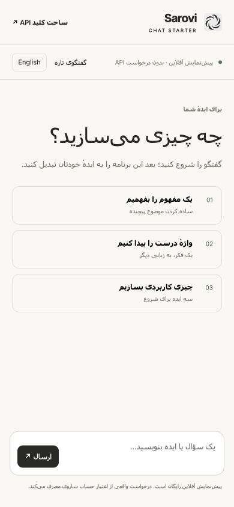

# چت آماده با API ساروی

یک برنامهٔ چت کوچک و کاربردی: پاسخ زنده، رابط فارسی و انگلیسی، کلید روی سرور و پیش‌نمایش آفلاین.

[English](README.md) · [ساخت کلید API](https://api.sarovi.site/developers/start?utm_source=github&utm_medium=organic&utm_campaign=developer_tools_202610&utm_content=sarovi-ai-chat-starter_key_fa) · [قیمت‌ها](https://api.sarovi.site/developers/pricing?utm_source=github&utm_medium=organic&utm_campaign=developer_tools_202610&utm_content=sarovi-ai-chat-starter_pricing_fa)



Node.js نسخهٔ ۲۴ به بالا لازم است؛ نصب کتابخانهٔ اضافی نیاز ندارد.

```sh
git clone https://github.com/sarovi-developers/sarovi-ai-chat-starter.git
cd sarovi-ai-chat-starter
npm run demo
```

نشانی `http://127.0.0.1:3317` را باز کنید. demo پاسخ ساختگی و مشخص دارد؛ درخواستی به مدل ارسال نمی‌شود و اعتبار مصرف نمی‌کند.

برای پاسخ واقعی، `.env.example` را به `.env` کپی کنید، کلید خصوصی ساروی را در آن بگذارید و `npm start` را اجرا کنید. دسترسی `responses:write` و سقف مصرف مناسب را در کنسول تنظیم کنید.

تاریخچه در حافظهٔ همین صفحه می‌ماند؛ با گفتگوی تازه یا بارگذاری مجدد پاک می‌شود. در حالت واقعی، پیام‌ها به ساروی و ارائه‌دهندهٔ مدل فرستاده می‌شوند. کلید به کد مرورگر یا GitHub منتقل نمی‌شود.

دکمهٔ توقف، شناسهٔ پیگیری و خطای پاسخ ناقص آماده‌اند. درخواست پولی خودکار تکرار نمی‌شود. پیش از استفادهٔ اینترنتی، [تنظیمات HTTPS و رمز برنامه](README.md#hosting) را انجام دهید. شمارندهٔ سادهٔ این نمونه جای احراز هویت و سقف مصرف پایدار یک سرویس عمومی را نمی‌گیرد.

`npm test` آزمون‌های آفلاین را اجرا می‌کند. [راهنمای اولین درخواست](https://api.sarovi.site/developers/start?utm_source=github&utm_medium=organic&utm_campaign=developer_tools_202610&utm_content=sarovi-ai-chat-starter_first_request_fa) · [نمونه‌کدهای بیشتر](https://github.com/sarovi-developers/sarovi-api-cookbook)

مجوز کد MIT است؛ مصرف API جداگانه محاسبه می‌شود.
