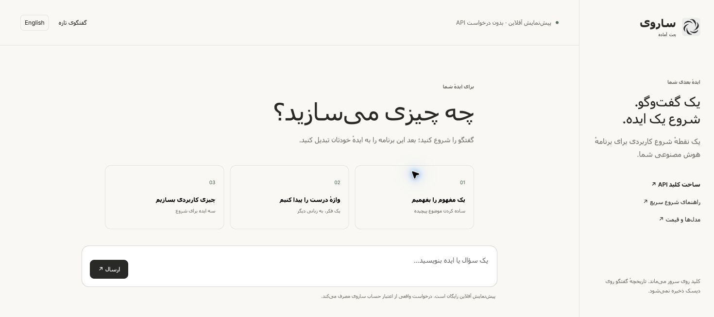

# چت آماده با API ساروی

یک برنامهٔ چت کوچک و کاربردی با پاسخ زنده، رابط فارسی، کلید روی سرور و پیش‌نمایش آفلاین؛ با Node.js، HTML، CSS و JavaScript، بدون مرحلهٔ ساخت رابط یا کتابخانهٔ اضافی.

[ساخت کلید API](https://api.sarovi.site/developers/start?utm_source=github&utm_medium=organic&utm_campaign=developer_tools_202610&utm_content=sarovi-ai-chat-starter_key_fa) · [مدل‌ها و قیمت‌ها](https://api.sarovi.site/developers/pricing?utm_source=github&utm_medium=organic&utm_campaign=developer_tools_202610&utm_content=sarovi-ai-chat-starter_pricing_fa) · [اولین درخواست](https://api.sarovi.site/developers/start?utm_source=github&utm_medium=organic&utm_campaign=developer_tools_202610&utm_content=sarovi-ai-chat-starter_first_request_fa)



## اول آفلاین امتحان کنید

Node.js نسخهٔ ۲۴ به بالا لازم است.

```sh
git clone https://github.com/sarovi-developers/sarovi-ai-chat-starter.git
cd sarovi-ai-chat-starter
npm run demo
```

نشانی [http://127.0.0.1:3317](http://127.0.0.1:3317) را باز کنید. پاسخ‌های نمایشی ساختگی و مشخص‌اند؛ به مدل درخواست نمی‌فرستند و اعتبار مصرف نمی‌کنند. رابط با فارسی و چیدمان راست‌به‌چپ باز می‌شود؛ تغییر زبان هم در دسترس است.

## اتصال حساب ساروی

```sh
cp .env.example .env
# کلید خصوصی ساروی را در .env وارد کنید.
npm start
```

کلید به دسترسی `responses:write` نیاز دارد. شناسهٔ فعلی مدل و قیمت آن را بررسی کنید و در کنسول ساروی برای کلید یا پروژه سقف مصرف کوچکی بگذارید. هر پاسخ حداکثر ۵۱۲ توکن خروجی دارد؛ این عدد سقف پولی نیست.

کلید روی سرور Node می‌ماند و به کد مرورگر فرستاده نمی‌شود. تاریخچه در حافظهٔ صفحه نگه داشته می‌شود و با گفتگوی تازه یا بارگذاری مجدد پاک می‌شود. در حالت واقعی، پیام‌ها به ساروی و ارائه‌دهندهٔ مدل ارسال می‌شوند؛ نگهداری داده به تنظیمات پروژه و ارائه‌دهنده بستگی دارد.

## امکانات نمونه

- رابط مناسب موبایل و رایانه، با فارسی و چیدمان راست‌به‌چپ.
- توقف پاسخ زنده، نمایش خطا و شناسهٔ پیگیری و تعداد توکن در صورت دریافت.
- بدون تولید پاسخ هنگام باز شدن صفحه یا تکرار خودکار درخواست پولی.
- زمینهٔ گفتگو محدود، حداکثر دو درخواست هم‌زمان و ده درخواست در دقیقه برای هر IP اتصال.
- بررسی میزبان و مبدأ درخواست؛ کلید در فایل عمومی یا پاسخ تنظیمات نیست.
- نمایش پاسخ مدل به‌صورت متن؛ کد HTML تولیدشده اجرا نمی‌شود.

## اجرای اینترنتی

برای اجرای اینترنتی، HTTPS را جلوی برنامه قرار دهید و متغیرهای سمت سرور را تنظیم کنید:

```text
HOST=0.0.0.0
PORT=8080
PUBLIC_ORIGIN=https://YOUR_APP_DOMAIN
APP_PASSWORD=YOUR_OWN_LONG_RANDOM_PASSWORD
```

در حالت میزبانی، رمز برنامه باید حداقل ۱۶ نویسه داشته باشد. رمز را در رابط وارد کنید؛ در حافظهٔ صفحه می‌ماند و در ذخیره‌سازی محلی مرورگر ثبت نمی‌شود. شمارنده‌های سادهٔ این نمونه برای هر پردازش جدا هستند و با راه‌اندازی مجدد صفر می‌شوند. پیش از رشد یک سرویس عمومی، احراز هویت کاربران و محدودیت مصرف پایدار اضافه کنید. این مخزن خودکار سرویس میزبانی ایجاد نمی‌کند؛ [ابر ساروی](https://cloud.sarovi.ir) برای گردش کار میزبانی در دسترس است.

## بررسی کد

```sh
npm test
```

آزمون‌های HTTP آفلاین، افشای کلید، رد مبدأ و میزبان نامعتبر، رمز برنامه، محدودیت ورودی و پایان ناقص پاسخ را بررسی می‌کنند. همهٔ مدل‌های زنده با این آزمون‌ها تأیید نشده‌اند.

[نمونه‌کدهای بیشتر](https://github.com/sarovi-developers/sarovi-api-cookbook) · [رفتار API و هزینه](docs/API-NOTES.md)

کد با مجوز [MIT](LICENSE.fa.md) منتشر شده است؛ مصرف API جداگانه محاسبه می‌شود و حقوق نشان ساروی جداست.
